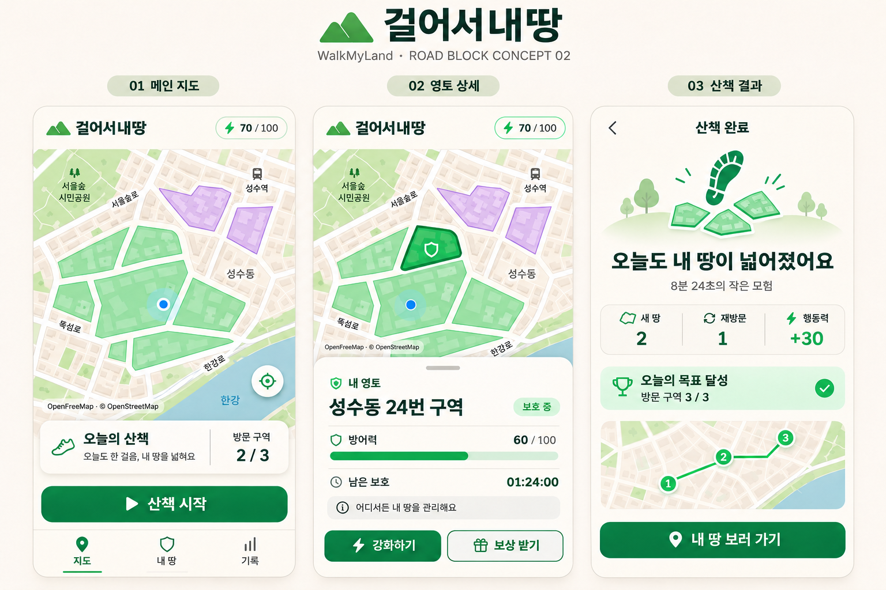

# WalkMyLand 문서

| 문서 | 내용 |
|---|---|
| [프로젝트 개요](OVERVIEW.md) | 명칭, 소개, 기본 방향 |
| [프로젝트 기획서](PROJECT_PLAN.md) | 도로 블록 단위 점령, 관리·전투·보상, MVP |
| [디자인 명세](design/DESIGN_SPEC.md) | 화면 구성, 시각 규칙, 상태별 동작 |
| [디자인 시안](design/road-block-concept-v2.png) | 메인 지도·영토 상세·산책 결과 |
| [시안 제작 기록](design/GENERATION_PROMPT.md) | 제작 방식과 최종 편집 프롬프트 |

## 최신 디자인

도로로 둘러싸인 블록 하나를 땅 하나로 사용합니다. 지도와 숫자는 설명용 예시입니다.

