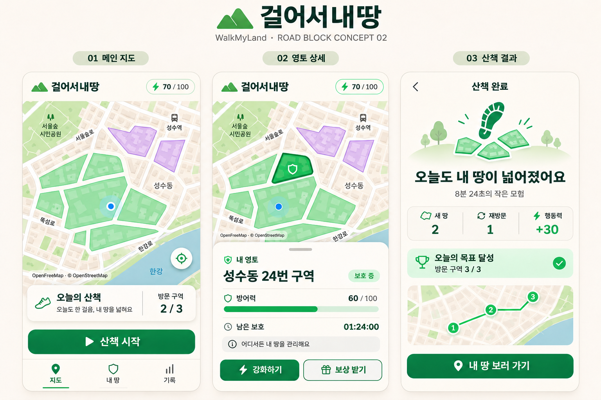

# 걸어서내땅 디자인 명세

2026-11-18 · 제안 v0.2 · 도로 블록 기반

## 기준

**도로로 둘러싸인 블록 하나 = 땅 하나.** 이전 육각형 아이디어를 대체한다. 확정된 것은 영토 단위이며, 색상·레이아웃·로고는 이번 디자인 제안이다. 이미지의 지도는 실제 데이터 캡처가 아닌 일러스트다. 구현 시 실제 도로 블록과 접근 가능한 보행 구간으로 연결한다.

## 시각 규격 제안

| 항목 | 기준 |
|---|---|
| 논리 화면 | 390 × 844 기준, 360~430 너비 대응 |
| 배경 / 카드 | #F8F6F0 / #FFFFFF |
| 기본 텍스트 | #14352D |
| 주 행동 / 내 영토 | #087E49 / 반투명 #64D699 |
| 다른 이용자 영토 | 반투명 #B697E2 |
| 현재 위치 | #168BFF + 정확도 반경 |
| 타이포그래피 | 시스템 한글 산세리프, 본문 16, 보조 13~14, 제목 22~26 |
| 간격 / 모서리 | 4·8·12·16·24, 카드 20, 버튼 16 |
| 주요 버튼 | 높이 52 이상, 터치 영역 최소 44 |
| 하단 영역 | 기기 안전 영역 포함, 지도 출처와 겹치지 않음 |

색상만으로 소유권을 표현하지 않는다. 선택된 땅에는 경계 강조와 방패·소유 상태 라벨을 같이 제공한다. 실제 구현 전 텍스트 대비와 글자 확대 시 레이아웃을 확인한다.

## 01 메인 지도

상단은 앱 이름과 행동력, 중앙은 지도, 하단은 오늘의 산책 카드·산책 시작 버튼·탭으로 구성한다. 지도에는 연한 건물과 도로 위에 소유 블록만 반투명하게 표시한다. 도로 영역은 색칠하지 않는다. 중립 땅은 탭했을 때 경계를 강조하고, 축소 화면에서는 과도한 경계선을 생략한다.

내 위치 버튼은 지도 오른쪽 아래에 둔다. 블록을 누르면 영토 상세 시트를 연다. 하단 탭은 지도 / 내 땅 / 기록이며, 내 땅 목록과 기록 화면의 상세 시안은 후속 범위다.

| 상태 | 버튼·안내 |
|---|---|
| 대기 | 산책 시작 |
| 위치 권한 없음 | 위치 권한 안내; 지도 탐색·기존 영토 관리는 유지 |
| 위치 확인 중 | 위치 확인 중; 확정 점령 연출 없음 |
| 산책 중 | 경과 시간·방문 수, 산책 종료 |
| 블록 귀속 불명확 | 위치를 확인하고 있어요; 자동 중복 점령 금지 |
| 연결 끊김 | 기록 확인 대기; 확정 보상과 대기 상태를 구분 |

지도 출처는 카드나 시트 위로 가리지 않고 항상 읽을 수 있는 별도 영역에 표시한다. 실제 사용 스타일에 포함된 출처도 유지한다.

## 02 영토 상세

선택 블록 전체를 강조하고 아래에서 시트를 연다. 구역 이름·소유 상태·방어력·보호 시간을 순서대로 표시한다. 시안의 60/100과 01:24:00은 예시다.

| 대상 | 동작 |
|---|---|
| 내 땅 | 강화하기 / 보상 받기 |
| 중립 땅 | 현장 방문 안내; 원격 신규 점령 버튼 없음 |
| 상대 땅·이번 시즌 방문 이력 있음 | 공격 비용·피해 예상 표시 후 공격 확인 |
| 상대 땅·방문 이력 없음 | 먼저 방문하면 공격할 수 있어요 |
| 상대 땅·보호 중 | 보호 종료 시간, 공격 비활성 |
| 자원 부족 | 필요 자원과 현재 자원 안내, 해당 행동 비활성 |
| 처리 중 | 중복 입력 방지, 완료 또는 실패 결과 표시 |

강화는 관리 자원, 공격은 행동력을 소비한다. 시안의 강화 버튼 번개 아이콘은 행동력과 혼동될 수 있으므로 구현에서는 방패+ 아이콘으로 교체한다. 비용 수치는 정해진 게임 규칙을 따른다. 보상 받기는 정산 가능량이 있을 때 활성화한다.

현재 위치는 블록 내부 진입을 뜻하지 않는다. 실제 산책 판정은 블록에 접한 접근 가능한 보행 구간에서 수행하며, 양쪽 도로 블록 중 어느 곳에 귀속할지 모호하면 확인 상태를 사용한다.

## 03 산책 결과

산책 시간, 새 땅 수, 재방문 수, 획득 행동력과 일일 목표 달성을 보여준다. 작은 경로 지도는 본인에게만 제공하며, 저장·공유 범위는 위치 데이터 정책 확정 후 정한다.

시안은 새 땅 2 + 재방문 1 = 방문 3으로 오늘의 목표를 달성한 예시다. 행동력 +30은 방문 보너스 합계이며 점령 비용 차감 후 순증가량이 아니다. 구현에서는 보상 합계와 사용량을 구분하고 현재 잔액을 별도로 보여준다. 8분 24초는 일일 목표 소요시간을 보장하는 수치가 아니다.

새 점령이 없으면 “오늘의 발걸음을 기록했어요”로 제목을 바꾸고 재방문 보상을 강조한다. 확인 대기 방문은 확정 수치에서 분리한다. 주요 버튼 “내 땅 보러 가기”는 내 땅 목록으로 연결한다.

## 동작과 범위

- 점령 완료 시 해당 블록을 짧게 강조하고 결과를 누적한다. 이동 중 반복 팝업을 띄우지 않는다.
- 시트는 지도 탭 또는 닫기로 닫을 수 있고, 접근성용 닫기 버튼을 제공한다.
- 줄어든 화면 높이와 글자 확대에서는 시트 내부를 스크롤하고 주요 버튼은 접근 가능하게 유지한다.
- 지도는 장식 이미지로 대체하지 않는다. 이 이미지는 구현 방향을 보여주는 제안서이며 실행 가능한 UI가 아니다.
- 아이콘·로고는 시안용 제안이다. 최종 벡터 자산과 앱 아이콘 제작은 별도 작업이다.
- 앱 코드와 테스트 코드는 이번 문서·시안 작업에 포함하지 않는다.
